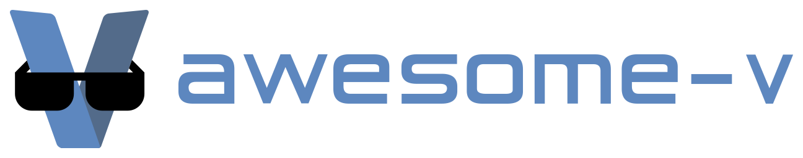

<!--lint disable no-dead-urls-->

# Awesome V  

> A curated list of awesome V frameworks, libraries, software and resources.

[V](https://vlang.io/) is a simple, fast, safe, compiled language for developing maintainable software.

Archived projects and those without recent activity are listed in [UNMAINTAINED.md](UNMAINTAINED.md).

## Contents

- [Applications](#applications)
	- [Build Systems](#build-systems)
	- [Command-line](#command-line)
	- [Editors](#editors)
	- [Games](#games)
	- [Graphics](#graphics)
	- [Interpreters/Compilers](#interpreterscompilers)
	- [Operating systems/Kernels](#operating-systemskernels)
	- [Package managers](#package-managers)
	- [Project management](#project-management)
	- [Serialization](#serialization)
	- [Utilities](#utilities)
	- [Web](#web)
- [Libraries](#libraries)
	- [Audio](#audio)
	- [Automation](#automation)
	- [Database clients](#database-clients)
	- [Discord](#discord)
	- [Eventing](#eventing)
	- [Game development](#game-development)
	- [Graphics](#graphics-1)
	- [Interoperability](#interoperability)
	- [Networking](#networking)
	- [Operating system](#operating-system)
	- [Scientific computing](#scientific-computing)
	- [Telegram](#telegram)
	- [Text processing](#text-processing)
	- [User Interface toolkits](#user-interface-toolkits)
	- [Utility](#utility)
	- [Web](#web-1)
- [Other](#other)
	- [Articles](#articles)
	- [Books](#books)
	- [Communities](#communities)
	- [Editor plugins](#editor-plugins)
	- [Forums](#forums)
	- [GitHub Actions](#github-actions)
	- [IDEs with V](#ides-with-v)
	- [Online IDEs with V](#online-ides-with-v)
	- [Operating Systems & OS Development Examples](#operating-systems--os-development-examples)
	- [Programming contests](#programming-contests)
	- [Tutorials](#tutorials)
	- [Videos](#videos)
	- [Contributors](#contributors)

## Applications

### Build Systems

- [clockwork](https://github.com/emmathemartian/clockwork) - A language-agnostic build tool wrote in V.
- [vab](https://github.com/vlang/vab) - The official V tool to build and package applications for Android.
- [vab-sdl](https://github.com/larpon/vab-sdl) - Standalone and extra command for `vab` to build and package
SDL2 and SDL3 based applications importing `vlang/sdl`.

### Command-line

- [dupfind](https://github.com/gabytz777/dupfind) - Find duplicate files by content. Pure V, zero dependencies, with JSON output.
- [fdup](https://github.com/gechandesu/fdup) - Find and remove duplicate files.
- [httest](https://github.com/gechandesu/httest) - A CGI-enabled HTTP test server for mocking backends, inspecting requests and simulating latency and failures.
- [klonol](https://github.com/hungrybluedev/klonol) - CLI tool to help you "clone all" Git repositories belonging to you. Works with GitHub and Gitea.
- [lsv](https://github.com/mike-ward/lsv) - `ls` file lister in the spirit of exa, eza, lsd, pls, natls, ls-go and others.
- [minimax-v](https://github.com/whiter001/minimax-v) - Local AI Agent runtime implemented in the V language.
- [pfjson](https://github.com/fleximus/pfjson) - A CLI tool to convert OpenBSD Packet Filter configuration files (`pf.conf`) to JSON and vice versa.
- [portctl](https://github.com/apoprotsky/portctl) - CLI tool to manage Docker Swarm resources using Portainer API.
- [v-terminal-apps](https://github.com/cogrow4/V-Terminal-Apps) - A collection of high-quality terminal applications written in V, including job planner, calculator, notes, file browser, quiz game, budget tracker, P2P chat (WIP), and Pomodoro timer.
- [v_llama_cpp](https://github.com/sakana-ctf/v_llama_cpp) - Lightweight V wrapper for Llama.cpp, enabling efficient LLM execution.
- [vfc](https://github.com/Ict00/vfc) - A simple TUI file manager, made with V.
- [vfetch](https://github.com/carlosqsilva/vfetch) - A macOS system information fetch written in V.
- [vgoogle](https://github.com/changhz/vgoogle) - Make google search on the terminal.
- [vlsh](https://github.com/vlshcc/vlsh) - *nix Shell written in V (pipes, plugins, mux mode, etc).
- [vqrcode](https://github.com/carlosqsilva/vqrcode) - CLI for creating QR Codes.
- [vsnap](https://github.com/skandhas/vsnap) - A tiny local snapshot tool for saving and restoring files before risky edits, lighter than Git and built around explicit paths.
- [vsqlite](https://github.com/quaesitor-scientiam/vsqlite) - SQLite CLI and module replacement written in pure V.
- [zilch](https://github.com/mike-ward/zilch) - An entertaining and amusing simulation of an installer.

### Editors

- [lilly](https://github.com/tauraamui/lilly) - TUI editor and VIM/Neovim alternative.
- [text_editor](https://github.com/vlang/v/blob/master/examples/term.ui/text_editor.v) - Small text editor from the official V examples.
- [ved](https://github.com/vlang/ved) - 1 MB text editor written in V with hardware accelerated text rendering. Compiles in <1s.
- [vee](https://github.com/Larpon/vee) - V Editor Engine. A V module providing the guts of a text editor. Comes with a [TUI editor example](https://github.com/Larpon/vee/blob/master/examples/tuieditor/).
- [volt](https://github.com/Volt-Editor-Team/volt) - Aims to be a fully featured text editor written entirely in Vlang.
- [vPDF](https://github.com/vlang/pdf) - A module to simplify PDF file creation using the V programming language.
- [vro](https://github.com/undivisible/vro) - <0.5MB micro-inspired basic text editor. Compatible with Micro's YAML syntax highlighting.

### Games

- [Dino](https://github.com/egevtech/dino) - A simple console arcade game written in V where you control a dino and avoid cactuses and birds.
- [flappylearning-v](https://github.com/vlang/v/tree/master/examples/flappylearning) - A simple flappy learning demo in v.
- [Kurarin](https://github.com/FireRedz/kurarin) - osu! beatmap visualizer made in V. [Example video](https://p153.p0.n0.cdn.getcloudapp.com/items/6quvQjb5/ce3ea737-eb29-4b8c-a5f3-65a804a2f56f.mp4).
- [minesweeper](https://github.com/ali-furkan/minesweeper-v) - A simple Minesweeper game written in vlang.
- [Puzzle Vibes](https://github.com/Larpon/puzzle_vibes) - A jigsaw-like puzzle game written in V using `shy`.
- [VCraft](https://github.com/gabytz777/vcraft) - A voxel sandbox game written entirely in V with procedural terrain, biomes, water, mining/building, and a hotbar HUD.
- [vchess](https://github.com/hedgeg0d/vchess) - Chess game written in V programming language.

### Graphics

- [vpaint](https://github.com/pisaiah/vpaint) - MS-Paint alternative written in V.

### Interpreters/Compilers

- [Aixt](https://github.com/fermarsan/aixt) - Programming framework for microcontrollers based on a V-based language and written in V. 
- [monkey_v](https://github.com/Delta456/monkey_v) - Implementation of [Thorsten Ball's Monkey Language](https://interpreterbook.com/) in V.
- [papyrus-compiler](https://github.com/russo-2025/papyrus-compiler) - Open-source compiler for Bethesda's Papyrus scripting language (Skyrim SE/AE).
- [v](https://github.com/vlang/v) - The language V itself. Simple, fast, safe, compiled language for developing maintainable software.
- [vas](https://github.com/v420v/vas) - A simple x86-64 assembler written in V.

### Operating systems/Kernels

- [Vinix](https://github.com/vlang/vinix) - Small and simple OS in V. Runs bash.
- [V-Unikernel](https://github.com/vlang/unikernel) - A unikernel is a computer program statically linked with the operating system code on which it depends.

### Package managers

- [vpm](https://github.com/vlang/vpm) - The V language package management tool written in V.

### Project management

- [create-vlang-app](https://github.com/Create-Vlang-App/create-vlang-app) - A V-native scaffolding CLI to generate production-ready V projects from composable templates and extensions.

### Serialization

- [ini-v](https://github.com/ldedev/ini-v) - Simple and practical module for manipulating ini/cfg file.
- [maple](https://github.com/emmathemartian/maple) - A very simple key-value config format wrote in V.

### Utilities

- [boj-server](https://github.com/hyperpolymath/boj-server) - Unified developer tool server using V for the network adapter layer. Exposes REST (port 7700), gRPC (7701), and GraphQL (7702) from a single V codebase. 18 capability cartridges loaded via Zig FFI with Idris2-verified interfaces.
- [qptorrent](https://github.com/qptorrent/qptorrent) - A minimal GUI/CLI BitTorrent client written in V + vlang/gui.
- [unix-emulators-win](https://github.com/Ddiidev/unix-emulators-win) - Collection of 16 UNIX utilities rewritten in V for Windows.

### Web

- [Gitly](https://github.com/vlang/gitly) - A light and fast SCM alternative to GitHub/GitLab written in V.
- [gitval](https://github.com/davlgd/gitval) - A static site generator for Git repositories, written in V.
- [highlighter](https://codeberg.org/tamer/highlighter) - Inject syntax highlighting into HTML files at build time, or via the CLI tool.
- [Mantis](https://github.com/khalyomede/mantis) - A web framework written in V.
- [Mustela](https://github.com/filipos800/mustela) - Ultra-high-performance static site generator (SSG) engineered for speed (>9,000 pages/sec) and total data sovereignty.
- [rr-dl](https://github.com/dy-tea/rr-dl) - Royal-Road Novel downloader.
- [Tiniest Veb Server](https://github.com/davlgd/tVeb) - A < 1MB static hosting web server written in V, based on `veb`. 🍃
- [v-vite starter](https://github.com/v-vite/starter) - A starter kit for Veb applications, preconfigured with Vite.js.
- [Vebview.JS](https://github.com/malisipi/Vebview.JS) - Electron/Neutralino.JS alternative written in V.
- [Verne](https://github.com/davlgd/Verne) - The other static site generator named after a famous French author.
- [vico_bot](https://github.com/KArjmand/vico_bot) - Lightweight self-hosted AI chatbot with persistent memory and tool calling.
- [vorum](https://github.com/vlang/vorum) - Open-source blogging/forum software written in V.

## Libraries

### Audio

- [miniaudio](https://github.com/larpon/miniaudio) - Bindings for the excellent miniaudio C audio library.

### Automation

- [v-webdriver](https://github.com/quaesitor-scientiam/v-webdriver) - A V language implementation of the W3C WebDriver protocol for browser automation.

### Database clients
<!-- lint disable awesome-spell-check -->
- [firebird](https://github.com/einar-hjortdal/firebird) - Client for Firebird SQL.
- [leveldb](https://github.com/vlang/leveldb) - Pure V implementation of LevelDB.
- [mongodb](https://github.com/vlang/mongo) - A MongoDB driver for V.
- [redict](https://github.com/einar-hjortdal/redict) - Client for Redict, a LGPL-3.0-only fork of Redis (compatible with Redis <=7.2.4).
- [vduckdb](https://github.com/rodabt/vduckdb) - A DuckDB client wrapper for V.
- [vredis](https://github.com/xiusin/vredis) - A simple, user-friendly, and comprehensive Redis client.
- [vsql](https://github.com/elliotchance/vsql) - Single-file SQL database written in pure V, following the SQL standard, with a CLI, a PostgreSQL-compatible server and an ORM.

### Discord

- [kitten](https://github.com/geniushq/kitten) - Simple Discord API library for writing bots.
- [viscord](https://github.com/vlang/viscord) - Pretty basic library for connecting to the Discord gateway.

### Eventing

- [eventbus](https://github.com/vlang/v/tree/master/vlib/eventbus) - A simple event bus system for V.
- [rxv](https://github.com/ulises-jeremias/rxv) - Reactive Extensions for the V language. Compose async event streams with creation, filtering, transformation, aggregation, timing, and combination operators.

### Game development

- [chipmunk2d](https://github.com/larpon/chipmunk2d) - V wrapper of the Chipmunk2D physics library.
- [sdl2test](https://github.com/nsauzede/sdl2test) - Exhaustive suite of tests and examples for SDL2 with V.
- [shy](https://github.com/Larpon/shy) - A foundation that helps you being creative in V.

### Graphics

- [sdl](https://github.com/vlang/sdl) - Official SDL2 & SDL3 bindings for V.
- [sgldraw](https://github.com/larpon/sgldraw) - An experimental real-time vector render V module based on `sokol.sgl`.
- [svgg](https://github.com/Avocadocs/svgg) - V module to load and resterize svg file into `gg.Image` object.
- [V Earcut](https://github.com/Larpon/earcut) - fast (real-time) polygon triangulation library based on [mapbox/Earcut](https://github.com/mapbox/earcut) to handle holes, twisted polygons, degeneracies and self-intersections.
- [vglyph](https://github.com/vlang/vglyph) - High-performance text rendering engine for the V programming language, built on Pango, FreeType, and Sokol.
- [vbmp](https://github.com/dy-tea/vbmp) - Read and write bitmap files.
- [voronoi](https://github.com/larpon/voronoi) - V wrapper of [JCash/voronoi](https://github.com/JCash/voronoi).
- [vsdl2](https://github.com/nsauzede/vsdl2) - A libSDL2 wrapper.
- [vsl.vcl](https://github.com/vlang/vsl/tree/main/vcl#readme) - VCL is a high level way of writing programs with OpenCL using V. These are highly opinionated OpenCL bindings for V. It tries to make GPU computing easy, with some sugar abstraction, V's concurrency and channels.
- [vsl.plot](https://github.com/vlang/vsl/tree/main/plot#readme) - Plotting module for VSL with 85+ examples. Create line charts, scatter plots, 3D surfaces, bar charts, box plots, histograms, heatmaps, and more.

### Interoperability

- [jni](https://github.com/larpon/jni) - V wrapper around the C Java Native Interface (Desktop + Android).
- [vjsx](https://github.com/guweigang/vjsx) - V bindings to quickjs javascript engine. Run JS in V.
- [vphp](https://github.com/guweigang/vphp) - Vlang library for building PHP extensions natively in Vlang.

### Networking

- [netaddr](https://github.com/gechandesu/netaddr) - IPv4, IPv6 and MAC (EUI-48, EUI-64) addresses manipulation library.
- [netio](https://github.com/gechandesu/netio) - Low-level networking library for V that gives more control over sockets.
- [vmq](https://github.com/jordan-bonecutter/vmq) -  V wrapper For [ZMQ](https://zeromq.org/) (aka ZeroMQ, ØMQ, 0MQ: a high-performance asynchronous messaging library).
- [webrtc-v](https://github.com/bedrock-v/webrtc-v) - A pure V implementation of the WebRTC protocol stack.
- [raknet](https://github.com/bedrock-v/raknet) - A V implementation of the classic RakNet protocol used by Minecraft: Bedrock Edition.

### Operating system

- [clipboard](https://github.com/vlang/v/tree/master/vlib/clipboard) - V module for interacting with the OS clipboard. Fully cross-platform.

### Scientific computing

- [vsl](https://github.com/vlang/vsl) - A Scientific Library with a great variety of different modules. Although most modules offer pure-V definitions, it also provides modules that wrap known C libraries among other backends that allow high performance computing as an alternative. Also provides opinionated wrappers for OpenBLAS, LAPACKE, MPI, OpenCL among other libraries.
- [vsl.fft](https://github.com/vlang/vsl/tree/main/fft#readme) - Fast Fourier Transform module for VSL. Includes real and complex FFT with multiple backend options.
- [vsl.ml](https://github.com/vlang/vsl/tree/main/ml#readme) - Machine Learning module for VSL with K-means, KNN, linear/logistic regression, SVM, decision trees, random forest, and more.
- [vsl.quaternion](https://github.com/vlang/vsl/tree/main/quaternion#readme) - Quaternion math module for VSL. Supports 3D rotations, spherical linear interpolation (slerp), and Julia fractal generation.
- [vstats](https://github.com/rodabt/vstats) - A dependency-free Linear Algebra, Statistics, and Machine Learning library written from scratch in V.
- [vtl](https://github.com/vlang/vtl) - The V Tensor Library is a numerical computing library supporting n-dimensional data structure, backed by VSL.
- [vtl.autograd](https://github.com/vlang/vtl/tree/main/autograd#readme) - Automatic differentiation module for VTL. Enables gradient computation for machine learning and optimization.
- [vtl.datasets](https://github.com/vlang/vtl/tree/main/datasets#readme) - Datasets module for VTL providing built-in datasets for ML benchmarking and tutorials.
- [vtl.nn](https://github.com/vlang/vtl/tree/main/nn#readme) - Neural Networks module for VTL. Build and train deep learning models with layers, activations, and optimizers.
- [NeuralNetworks-V-Module](https://github.com/Eliyaan/NeuralNetworks-V-Module) - This is a V module to create neural networks.

### Telegram

- [vgram](https://github.com/dariotarantini/vgram) - Telegram bot library.

### Text processing

- [vsoup](https://github.com/marcalc/vsoup) - A fast, JSoup-inspired HTML5 parser and DOM manipulation library for V, powered by Lexbor.
- [xlsx](https://github.com/hungrybluedev/xlsx) - V library for reading and writing Microsoft Excel files.
- [lexical_uuid](https://github.com/einar-hjortdal/lexical_uuid) - Lexicographically-sortable universally unique identifiers.

### User Interface toolkits

- [bobatea](https://github.com/tauraamui/bobatea) - TUI framework inspired by Bubble Tea.
- [iUI](https://github.com/isaiahpatton/ui) - Isaiah's cross-platform GUI library for V. Inspired by the syntax of Java's Swing.
- [V UI](https://github.com/vlang/ui) - Integrated cross platform UI toolkit for Windows, macOS, Linux, Android, iOS and the web.
- [V-WebUI](https://github.com/webui-dev/v-webui) - A wrapper for WebUI. A lightweight library that allows you to use any web browser as a GUI, with V in the backend and HTML5 in the frontend.

### Utility

- [dotenv](https://github.com/einar-hjortdal/dotenv) - Loads environment variables from a .env file for development purposes.
- [json2v](https://github.com/ldedev/Json2V) - Convert a json to a struct in Vlang.
- [structlog](https://github.com/gechandesu/structlog) - Structured logs library for V.
- [V-crypto](https://github.com/bstnbuck/V-crypto) - Implementation of additional cryptographic algorithms.
- [v-hash](https://github.com/deatil/v-hash) - A hash library for vlang.
- [v-rsa](https://github.com/deatil/v-rsa) - A RSA library for vlang.
- [vdotenv](https://github.com/zztkm/vdotenv) - Support for .env files which loads environment variables.

### Web

- [blobly](https://github.com/einar-hjortdal/blobly) - Central file server.
- [jsonrpcv](https://github.com/Te4nick/jsonrpcv) - JSON-RPC 2.0 client+server implementation in pure V.
- [sessions](https://github.com/einar-hjortdal/sessions) - Web-framework-agnostic sessions library.
- [swelte](https://github.com/eddow/swelte) - "V in Svelte" - SvelteKit equivalent using V as backend and isomorphic code.
- [v-jwt](https://github.com/deatil/v-jwt) - A JWT (JSON Web Token) library for vlang.
- [v-sm3](https://github.com/deatil/v-sm3) - A SM3 hash function for vlang.
- [veb](https://github.com/vlang/v/tree/master/vlib/veb) - V's built-in web framework.
- [viltrum](https://github.com/Tuntii/viltrum) - Web framework with its own HTTP/1.1, HTTP/2, WebSocket and TLS 1.3 engine, zero allocations per request.
- [vite.v](https://github.com/siguici/vite.v) - Seamless [Vite.js](https://vite.dev) integration for Veb applications.

## Other

### Articles

- [An introduction to V](https://simonknott.de/articles/VLang.html)
- [How To Make A V Compiler Backend](https://l-m.dev/cs/how_to_make_a_v_backend) - Walkthrough of writing a new codegen backend for V.
- [The V WebAssembly Compiler Backend, Rewritten](https://l-m.dev/cs/the_v_webassembly_compiler_backend_rewrite) - Rewriting V's WebAssembly backend with no external dependencies.

### Books

- [Getting Started with V Programming - Navule Pavan Kumar Rao - Packt 2021 Dec](https://www.amazon.com/Getting-Started-Programming-end-end-ebook/dp/B09FKK3JL7/ref=sr_1_1?keywords=Getting+started+with+V+programming&qid=1639480830&sr=8-1) - Introductory book on V.

### Communities

- [V Community](https://github.com/v-community)

### Editor plugins

- [tree-sitter-v](https://github.com/undivisible/tree-sitter-v) - Tree-sitter grammar for V language. Maintained fork with modern API, crates.io package, 244 node types.

#### VS Code

- [vscode-vlang](https://github.com/vlang/vscode-vlang) - V Language extension for Visual Studio Code.
- [v-analyzer](https://github.com/vlang/v-analyzer) - Bring IDE features for the V programming language to VS Code.

#### Zed
- [zed-v](https://github.com/lv37/zed-v) - Support for V syntax highlighting in Zed.

### Forums

- [r/vlang](https://www.reddit.com/r/vlang)
- [Stack Overflow](https://stackoverflow.com/questions/tagged/vlang)

### GitHub Actions

- [setup-v](https://github.com/vlang/setup-v) - GitHub Action to install and use V in your workflow. Available on the [marketplace](https://github.com/marketplace/actions/setup-vlang).

### IDEs with V

- [Vide](https://github.com/IsaiahPatton/Vide)

### Online IDEs with V

- [V Playground](https://play.vlang.io)
- [V Playground (old)](https://v-wasm.now.sh/)

### Operating Systems & OS Development Examples

- [limine-v-template](https://github.com/plos-clan/limine-v-template) - A simple template for building a Limine-compliant kernel in V.

### Programming contests

- [Advent of Code 2022](https://github.com/vlang/adventofcode) - Solution of Advent of Code 2022 in V.
- [Rosetta Code in V](https://rosettacode.org/wiki/Category:V_(Vlang)) - Solutions for Rosetta Code in V.

### Tutorials

- [V for Node Devs](https://github.com/Thigidu/vlang-for-nodejs-developers) - Vlang for node js developers.

### Videos

- [The V Programming Language](https://www.youtube.com/channel/UCLZIElNyubHOvbfudT7KS1A)
- [V Programming Tutorials](https://www.youtube.com/watch?v=BVCuZ7z7GMY&list=PLEPMhdsq-gNpFr40A-ZnX-Hu9l-Sp5Oc_)

### Contributors

Made with [contributors-img](https://contrib.rocks).
